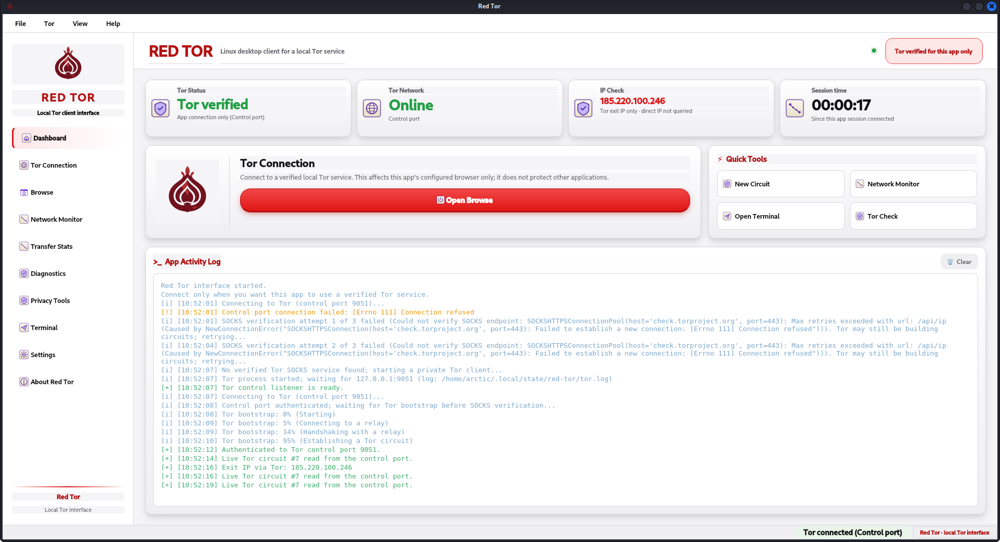
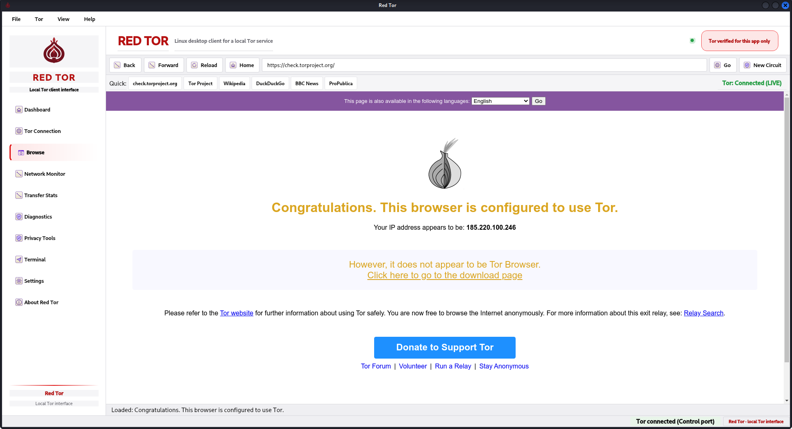
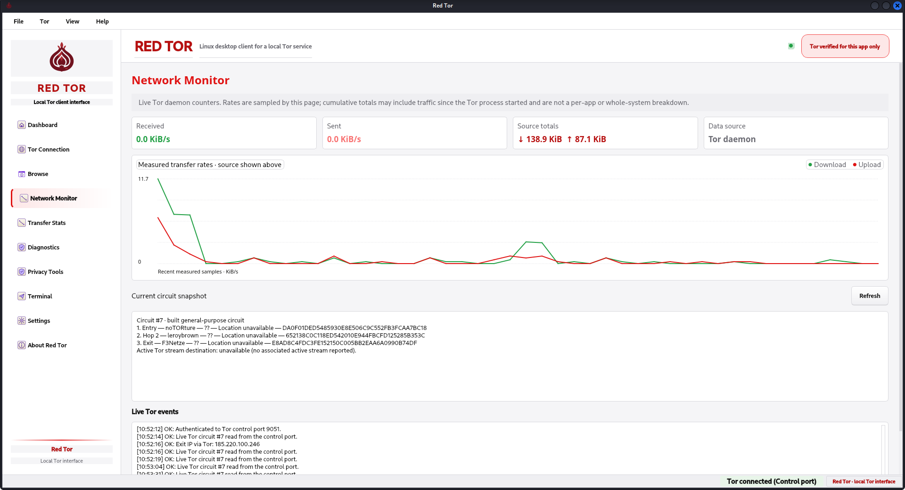
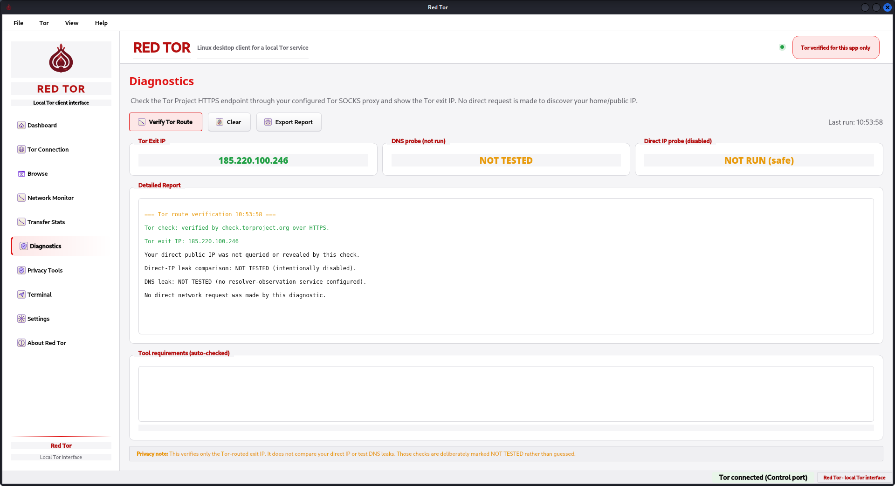
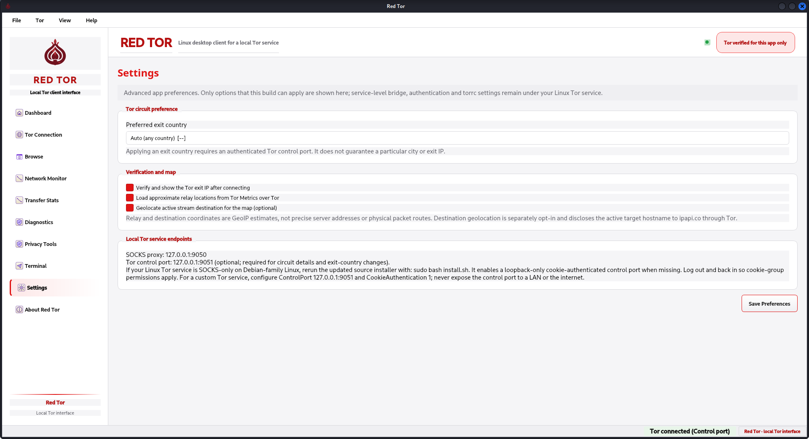
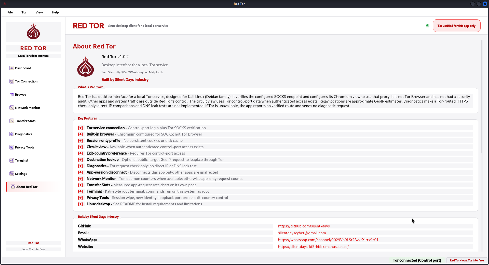

<div align="center">


# Red Tor

**A Modern Linux Desktop Interface for Tor Connection Management**

Connect • Monitor • Browse • Manage


</div>

---

## About Red Tor

**Red Tor** is a Linux desktop interface for managing and interacting with a **local Tor service** through a clean graphical interface.

It brings Tor connection management, circuit information, an embedded Tor-routed browser, network monitoring, diagnostics, privacy tools, settings, and a real terminal into one desktop application.

Red Tor is designed primarily for **Kali Linux and Debian-family Linux systems**.

The application is built with:

- Python 3
- PyQt5
- PyQtWebEngine
- Stem
- Requests
- PySocks
- Matplotlib
- Tor

> **Important:** Red Tor is **not Tor Browser**. It does not route or firewall the entire computer, does not provide Tor Browser's complete anti-fingerprinting protections, and has not undergone an independent security audit. A verified Tor connection does not guarantee anonymity.

---

# Screenshots

## Dashboard

The Dashboard provides an overview of the current Tor state, verification status, exit IP, session time, quick tools, and application activity.

<div align="center">



</div>

---

## Tor Browser

Red Tor includes an embedded Chromium browser configured to use the local Tor SOCKS proxy.

<div align="center">



</div>

The browser blocks requests while Tor has not been verified. It is designed for Tor-routed browsing through the application's configured SOCKS endpoint.

> The embedded browser is **not Tor Browser** and does not reproduce Tor Browser's complete privacy and anti-fingerprinting protections.

---

## Network Monitor

The Network Monitor displays available Tor daemon traffic counters, measured transfer rates, circuit information, and live Tor events.

<div align="center">



</div>

The application uses real Tor control data when available. App-side fallback counters are clearly labelled and do not represent complete system-wide traffic.

---

## Diagnostics

The Diagnostics page provides a Tor-routed HTTPS verification check and displays the reported Tor exit IP.

<div align="center">



</div>

Diagnostics intentionally does **not** query the user's direct public IP or perform a comprehensive DNS leak test.

---

## Settings

The Settings page provides supported Tor circuit and verification preferences, including exit-country selection and optional map/GeoIP features.

<div align="center">



</div>

---

## About Red Tor

The About page contains Red Tor information, technology details, features, project information, and contact links.

<div align="center">



</div>

---

# Features

| Feature | Description |
|---|---|
| **Dashboard** | View Tor status, exit IP, session information, quick tools, and activity logs. |
| **Tor Connection** | Connect to and manage the local Tor service. |
| **Circuit View** | View relay information reported by Tor's authenticated control interface. |
| **Circuit Map** | Display approximate GeoIP locations of Tor relays. |
| **Embedded Browser** | Chromium browser configured through the local Tor SOCKS proxy. |
| **New Circuit** | Request a new Tor circuit when control-port access is available. |
| **Exit Country** | Select a preferred Tor exit country when authenticated control access is available. |
| **Network Monitor** | Monitor Tor daemon counters and application-side traffic measurements. |
| **Transfer Stats** | View measured application-side transfer-rate samples. |
| **Diagnostics** | Perform a Tor-routed HTTPS route verification. |
| **Privacy Tools** | Clear the application browser session, request a new identity, probe local Tor ports, and manage connection privacy options. |
| **Settings** | Configure supported Tor circuit and GeoIP preferences. |
| **Terminal** | Provides a real root shell through a pseudo-terminal. |
| **Light UI** | Clean white interface with Inter typography, gradients, animations, and status indicators. |

---

# Application Sections

Red Tor currently includes:

- Dashboard
- Tor Connection
- Browse
- Circuit View
- Circuit Map
- Network Monitor
- Transfer Stats
- Diagnostics
- Privacy Tools
- Settings
- Terminal
- About

---

# Technology Stack

| Technology | Purpose |
|---|---|
| **Python 3** | Core application |
| **PyQt5** | Desktop GUI |
| **PyQtWebEngine** | Embedded Chromium browser |
| **Stem** | Tor control-port communication |
| **Requests** | HTTP communication |
| **PySocks** | SOCKS proxy support |
| **Matplotlib** | Charts and transfer graphs |
| **Tor** | Onion-routing service |
| **Inter** | Application typography |

---

# Requirements

Red Tor is designed for Linux desktop environments.

### Recommended

- Kali Linux
- Debian
- Ubuntu
- Python 3
- Tor
- Internet connection
- Desktop environment with GUI support

The included installer automatically handles supported dependencies.

---

# Installation

## 1. Clone the Repository

```bash
git clone https://github.com/silent-days/Red-Tor.git
```

## 2. Enter the Project

```bash
cd Red-Tor
```

## 3. Enter the Application Directory

```bash
cd red-tor-v1.0.2
```

## 4. Install Red Tor

For a system-wide Debian-family installation:

```bash
sudo bash install.sh
```

> **Important:** Do not use `sudo apt install.sh`.  
> The correct command is `sudo bash install.sh`.

The installer can:

- Install required Linux dependencies
- Install Python dependencies
- Configure the local Tor control interface when required
- Preserve existing active control-port configuration
- Install Red Tor under `/opt/red-tor`
- Create the `red-tor` command
- Create a desktop application entry
- Configure login autostart
- Prepare the application environment

---

# Launch Red Tor

After installation:

```bash
red-tor
```

You can also launch Red Tor from your Linux application menu.

Red Tor normally does **not** need to be launched with `sudo`.

The application starts **disconnected**. You choose when to connect to Tor.

---

# Tor Endpoints

Red Tor expects the standard local Tor endpoints:

| Service | Address | Purpose |
|---|---|---|
| **SOCKS Proxy** | `127.0.0.1:9050` | Routes supported application/browser traffic through Tor. |
| **Control Port** | `127.0.0.1:9051` | Authenticated local Tor control operations. |

On Debian-family systems, the installer can configure a loopback-only control port with cookie authentication when the required active configuration is missing.

Existing active control-port directives are preserved.

If your Tor configuration uses a different port or authentication method, some Red Tor control features may remain unavailable.

---

# First Launch

1. Start **Red Tor**.
2. Open the **Dashboard**.
3. Connect to the local Tor service.
4. Wait for Tor verification.
5. Open **Browse** after the Tor session is verified.
6. Use the monitoring, circuit, diagnostics, privacy, and settings pages as required.

Red Tor does not automatically connect to Tor during normal application startup.

---

# Login Autostart

The installer may configure Red Tor to start automatically when the desktop user logs in.

If you do not want Red Tor to start automatically, use the included script:

```bash
cd red-tor-v1.0.2
bash disable-autostart.sh
```

This removes the Red Tor login autostart entry without uninstalling the application.

To check the user autostart directory:

```bash
ls -la ~/.config/autostart/
```

To check whether Red Tor is running:

```bash
ps aux | grep -iE "red-tor|silent-tor"
```

---

# Data Locations

Red Tor uses local application state.

| Data | Location |
|---|---|
| System installation | `/opt/red-tor/` |
| User state | `~/.local/state/red-tor/` |
| Tor runtime data | `~/.local/state/red-tor/tor-data/` |
| Existing settings | `~/.silent-tor/` |

Existing compatible Tor runtime data can be migrated into the Red Tor state directory.

Migration does not intentionally delete the original source data.

---

# Privacy & Security

Red Tor is designed to make local Tor management easier, but it should not be treated as a complete anonymity solution.

### Important limitations

- **Not Tor Browser**  
  The embedded Chromium browser does not provide Tor Browser's complete anti-fingerprinting protections.

- **Not system-wide Tor**  
  Red Tor does not force every application on the computer through Tor.

- **No firewall kill switch**  
  Red Tor does not firewall the entire system if Tor becomes unavailable.

- **No anonymity guarantee**  
  Tor cannot prevent identity disclosure caused by accounts, downloads, malware, browser behavior, or user actions.

- **Circuit locations are approximate**  
  Relay GeoIP locations are estimates and are not exact physical server locations.

- **Diagnostics are limited**  
  The diagnostic check verifies a Tor-routed HTTPS connection. It does not perform a direct public-IP comparison or comprehensive DNS leak test.

- **Terminal has real system privileges**  
  The Terminal page provides a real root shell. Commands can modify or delete system files.

Only execute commands you understand.

---

# Browser Privacy Design

The embedded browser uses the configured Tor SOCKS proxy and blocks browser requests when Tor has not been verified.

The browser also includes protections such as:

- Tor-only request gating
- SOCKS proxy routing
- Tor-side hostname resolution configuration
- DNS-over-HTTPS disabled
- QUIC/UDP disabled
- Off-the-record browser profile
- No persistent browser cookies
- Reduced Chromium background networking

These features improve the application's Tor-routed browsing behavior, but they **do not make the browser equivalent to Tor Browser**.

---

# Development & Testing

Enter the application directory:

```bash
cd red-tor-v1.0.2
```

## Compile Python Files

```bash
python3 -m compileall -q tor_core.py red_tor.py gui tests
```

## Run Tests

```bash
python3 -m unittest discover -s tests -v
```

## Check Shell Scripts

```bash
bash -n install.sh install-system.sh install-user.sh install-deps.sh run.sh uninstall-user.sh disable-autostart.sh
```

The repository contains automated tests covering Tor management, map data, import order, and root-launch behavior.

---

# Project Structure

```text
Red-Tor/
│
├── README.md
├── LICENSE
├── logo.png
│
├── Example/
│   ├── 1.png
│   ├── 2.png
│   ├── 3.png
│   ├── 4.png
│   ├── 5.png
│   └── 6.png
│
└── red-tor-v1.0.2/
    │
    ├── red_tor.py
    ├── tor_core.py
    ├── requirements.txt
    │
    ├── install.sh
    ├── install-system.sh
    ├── install-user.sh
    ├── install-deps.sh
    ├── run.sh
    ├── uninstall-user.sh
    └── disable-autostart.sh
    │
    ├── gui/
    │   ├── main_window.py
    │   ├── tor_panel.py
    │   ├── animations.py
    │   ├── circuit_view.py
    │   ├── world_map.py
    │   └── tabs/
    │       ├── dashboard.py
    │       ├── browse.py
    │       ├── diagnostics.py
    │       ├── network_monitor.py
    │       ├── privacy_tools.py
    │       ├── settings.py
    │       ├── terminal.py
    │       └── transfer.py
    │
    ├── assets/
    │   ├── fonts/
    │   ├── icons/
    │   └── natural-earth-110m-land.geojson
    │
    └── tests/
        ├── test_engine_import_order.py
        ├── test_map_data.py
        ├── test_root_launch.py
        └── test_tor_manager.py
```

---

# Version

**Current Version: 1.0.2**

Red Tor v1.0.2 includes improvements to:

- Tor connection handling
- Browser routing
- DNS protection
- Requirements checking
- Diagnostics
- Network monitoring
- Transfer statistics
- Privacy tools
- Terminal behavior
- UI animations
- Light theme
- Layout responsiveness
- Root-launch handling
- Installation and autostart management

---

# License

Red Tor is released under the **MIT License**.

See the [`LICENSE`](LICENSE) file for the complete license text.

---

# Repository

**GitHub:**  
https://github.com/silent-days/Red-Tor

If you find **Red Tor** useful, consider giving the repository a ⭐ star.

---

<div align="center">


### RED TOR

**Connect • Monitor • Browse • Manage**

Developed by **Silent Days**

</div>
